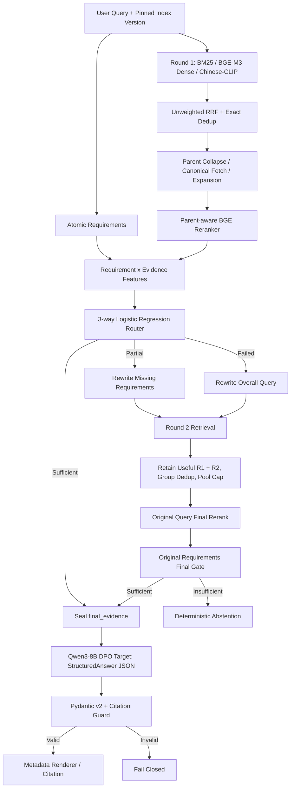

# Controlled Agentic RAG

**面向技术手册问答的受控、可追溯 RAG 架构** · Parent-aware Retrieval · Evidence Routing · Bounded Round2 · Structured Answer · Citation Guard

> **当前仓库状态：GitHub 展示 / 离线控制流可测试版本（不是生产部署验证）。** 本仓库将旧 Agentic Hybrid RAG 代码保留在 [`legacy/`](legacy/)，新增独立的 `controlled_rag` 核心包。无需模型权重即可运行**明确标注为虚构的演示**与单元测试。原始 Tesla PDF、模型、Mongo/Milvus 索引和历史评测产物均未包含，完整线上链路尚未验证。

## 为什么重构

旧流程由 LLM Judge 决定“证据够不够”，二次检索后直接生成，可能出现证据不足放行、引用越权或结果缺少版本边界。新版目标是把 **Evidence Sufficiency 当作系统控制状态**，同时把内容生成和来源验证分离。



**关键约束**：Child 负责召回，Parent/Image Evidence 负责重排与回答；最多两轮检索；Round2 必须保留已覆盖需求的有效证据；最终只允许基于当前 Request 的 sealed Evidence IDs 作答；Pydantic 验证结构，Citation Guard 验证 ID/授权/版本（**不等于语义事实校验**）。

## 哪些已经实现、哪些还要接真实环境

| 范围 | 当前状态 | 入口 |
|---|---|---|
| Pydantic v2 数据契约、Source Metadata、权限和 Version 检查 | ✅ 新版代码 + 单测 | `src/controlled_rag/contracts.py` |
| 三路 Hit 融合、RRF、Parent Collapse、Canonical Batch Fetch、Evidence Group 去重 | ✅ 算法/接口 + 合成测试；真实索引未接通 | `retrieval.py` |
| Atomic Requirements × Evidence 六特征、三态 LR 推理 | ✅ 特征和训练权重导入；**真实权重/阈值缺失** | `routing.py`, `scripts/train_router.py` |
| Partial / Failed 分流、一次 Round2、原始 Query 最终重排与再次门控 | ✅ 状态机 + 合成测试 | `orchestrator.py` |
| StructuredAnswer JSON、Pydantic、引用合法性及 Metadata Renderer | ✅ 逻辑 + 合成测试；语义支持率待评测 | `citations.py`, `generation.py` |
| 进程内 Index Pointer Pin/Activate、演示用有界 Admission Control | ✅ 本地组件 + 单测；不等于生产级分布式治理 | `index_registry.py`, `admission.py` |
| 微调 BGE Reranker、Qwen3-8B DPO（目标）/SFT（对照）/Base（对照） | ◐ 模型接口和 Pipeline 桥接代码已实现；DPO 权重缺失，所有真实模型未验证 | `adapters/models.py`, `adapters/qwen3_dpo.py`, `src/controlled_answer/` |
| Mongo/老索引迁移、Chinese-CLIP 实际服务、Qwen3-1.7B 拆解 | ◐ 严格接口/适配点；缺真实数据映射 | `adapters/`, `docs/MIGRATION.md` |
| 分层评测算法、合成安全探针、回归门禁、压测脚本 | ✅ 源码 + 合成离线测试；**不是实际模型指标** | `src/controlled_rag/evaluation/`, `eval/`, `docs/EVALUATION.md` |
| DPO 权重恢复、真实容量压测、真实 ACL 服务、灰度切换与历史指标复现 | ⬜ 后续接环境并实测 | `docs/STATUS.md` |

这里的 ✅ 只代表**所列的代码层和测试层**，不表示真实 Tesla 数据、生产服务或历史指标已经复现。

## 运行：无需 GPU 的虚构示例

要求 Python 3.10+。

```bash
python -m pip install -e '.[test]'
python -m pytest -q
python -m controlled_rag.demo --query '如何开启儿童锁，以及儿童锁影响哪些车门？'
python -m controlled_rag.demo --query '手册里有没有火箭发动机？'
```

第一个示例展示 `Partial → Round2 → Sufficient → Answered`；第二个示例展示 `Failed → Round2 → Failed → Abstained`，**不会调用生成模型**。示例数据的事实是人为编写的，**不能作为真实 Tesla 使用说明**。

可选的 FastAPI 演示（只启动虚构数据）：

```bash
python -m pip install -e '.[api]'
RAG_MODE=demo uvicorn controlled_rag.api:app --host 127.0.0.1 --port 9000
curl -X POST http://127.0.0.1:9000/chat \
  -H 'Content-Type: application/json' \
  -d '{"query": "如何开启儿童锁"}'
```

**未设置 `RAG_MODE=demo` 时，不会误把合成服务当成真实服务启动。** 线上权重、Mongo、Milvus、权限、索引 Manifest 必须单独接入，详见 `docs/MIGRATION.md`。

## Evaluation & Reproducibility（新增）

这一版新增了完整的 **评测代码框架、标准化数据接口、Pipeline 事件采集、安全探针和 CI Gate**，但只有合成数据/Mock 测试通过，**没有任何新的真实 DPO、GPU 或 Tesla 指标**。

```bash
python -m pip install -e '.[test]'
python -m pytest -q
python eval/run_all.py
python scripts/collect_eval_traces.py --mode synthetic --cases eval/data/pipeline_cases_synthetic.jsonl --output outputs/eval_trace
```

当前支持 Parent/Image Recall@K、MRR/NDCG、Reranker 前后对比、Evidence Router Macro-F1/False-Sufficient/Brier/ECE、Round2 Trigger/Rescue/Coverage、Base/SFT/DPO JSON 和拒答表现、Citation Validity 和**需独立标注**的 Semantic Support、Prompt Injection/ACL 用例记录、QPS/P95/P99、配对消融、Bad Case 回归、数据泄漏审计及 Release Gate。

- 核心实现：[`src/controlled_rag/evaluation/`](src/controlled_rag/evaluation/)
- 使用说明及运行命令：[`eval/README.md`](eval/README.md)
- 输入 Schema 和分母政策：[`eval/data/SCHEMAS.md`](eval/data/SCHEMAS.md)
- 哪些真实试验尚未执行：[`docs/EVALUATION.md`](docs/EVALUATION.md)

**注意：** `eval/data/*_synthetic.jsonl` 的 Base/SFT/DPO 数据都只是人为构造的例子，不能用于声称已复现模型增益。DPO 是默认目标模型，**绝无缺权重时自动退回 SFT 的逻辑**。

## 项目目录

```text
.
├── src/controlled_rag/
│   ├── contracts.py          # Request / Manifest / Evidence / StructuredAnswer
│   ├── retrieval.py          # RRF / Parent Collapse / Canonical Expansion
│   ├── routing.py            # Six Features / Trained LR Inference
│   ├── orchestrator.py       # At-most-2-round State Machine
│   ├── generation.py         # Sealed Evidence -> StructuredAnswer model boundary
│   ├── citations.py          # Citation Guard + Renderer
│   ├── index_registry.py     # Local version-pin / index pointer policies
│   ├── admission.py          # Local bounded admission policy
│   ├── adapters/             # Mongo / Model / DPO bridge / Legacy Index
│   ├── evaluation/           # Metrics, schemas, tracing, release gates
│   ├── demo.py               # Synthetic controlled scenarios
│   └── api.py                # Synthetic FastAPI only
├── src/controlled_answer/     # DPO-first Qwen3 Base/SFT/DPO adapters
├── eval/                      # Synthetic fixtures, reproducibility, benchmarks
├── scripts/
│   ├── train_router.py       # Train new six-feature LR; export auditable JSON
│   └── validate_evidence.py  # Canonical Evidence schema / version validation
├── tests/                    # Unit & state-machine safety tests
├── examples/                 # Publicly shareable synthetic sample only
├── docs/                     # Architecture, migration, limits, interview notes
├── legacy/                   # Original uploaded source snapshot; NOT active runtime
├── .github/workflows/ci.yml # Lightweight no-model CI
└── .gitignore                # No weights, datasets, private indexes or keys
```

## 准备真实数据 / 模型时

- `data/`、PDF、完整数据集、BM25/Milvus 文件、SFT/Reranker Checkpoint 都留在本地或合适的私有存储，不提交 Git。
- `model_weights ≠ code`：**已有 Reranker 和 Qwen3-8B SFT 可作为候选适配资产，DPO 是目标模型但权重丢失；不能未经验证声称真实 DPO 或新 JSON 行为已复现**。
- 原代码中 ORPO 相关脚本保留作历史资料，**不是 DPO 训练代码**，也不意味着 DPO Checkpoint 仍然存在。
- `.gitignore` 只阻止**未来尚未跟踪的文件**被上传；如果曾经提交过密钥/数据，需要处理 Git 历史。
- 如需重新训练证据 LR Router，在准备好私有 train/dev 特征和标签后安装 `python -m pip install -e '.[train]'`，再调用 `scripts/train_router.py`；它不是历史训练结果的自动复现。

## 阅读路线

先看 [`docs/ARCHITECTURE.md`](docs/ARCHITECTURE.md)（为什么要这样设计），再看 [`docs/EVALUATION.md`](docs/EVALUATION.md)（评测方法和边界），然后看 [`docs/STATUS.md`](docs/STATUS.md)（哪些真完成），然后看 [`docs/MIGRATION.md`](docs/MIGRATION.md)（怎么接旧代码和真实数据）。面试准备使用 [`docs/INTERVIEW.md`](docs/INTERVIEW.md)。

**历史指标提醒**：旧实验文档报告过检索、Router、DPO 和容量指标，但本仓库未包含复现实验的全部数据/权重与原始 run artifacts。历史记录与本次源码测试结果必须分开呈现；参见 `docs/STATUS.md`。
