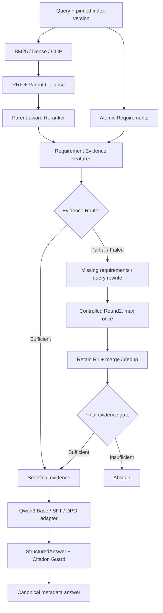

# Controlled Agentic RAG

**Evidence-grounded, bounded-agent RAG for technical-manual question answering.**

一个强调证据充分性与可追溯回答的 Agentic RAG 工程：结合 **BM25 / Dense / CLIP** 多路召回、**RRF + Parent-aware Reranking**、三态 **Evidence Router**、受控 **Round2**、以及 **Structured Answer + Citation Guard**。组件围绕技术手册问答设计，支持索引版本固定、证据封存和 fail-closed 拒答。


## Architecture



**核心约束：** 一个 Request 固定一个 Index Version；先门控证据再生成；最多两轮检索；Round2 保留 R1 有效证据；回答中的 Citation ID 必须属于封存的可引用集合。Citation Guard 校验身份/元数据，语义真实性仍应单独评估。

## Published run — maintainer-reported records

>  **来源与认证范围**：维护者声明 `RUN-EXAMPLE-2026-001` 下的 300 条 Query 记录来自真实实验（Gold 可回答 222、不可回答 78）。本仓库能从逐条 JSONL 复算下列指标，但未包含可独立验证的模型执行、Gold 标注/人工复核或真实 GPU 采样原始日志。

| 指标 | 对照 | 完整方案 | 说明 |
|---|---:|---:|---|
| Grounded success / input | 67.0% | **81.7%** | 300 个配对问题 |
| Correct answer / answerable | 64.4% | **77.5%** | 222 个可回答问题 |
| Child Recall@10 | 87.7% | **94.7%** | BM25 vs Hybrid |
| Reranker NDCG@5 | 0.801 | **0.851** | 相同候选集合 |
| Evidence Router Macro-F1 | 0.745 | **0.933** | Gold 三状态 |
| Round2 Rescue (eligible) | — | **71.3%** | 仅触发且 Gold 可回答案例 |
| DPO faithfulness (judged answers) | 89.8% (SFT) | **95.7%** | 双 reviewer 标签（人工来源未独立核验） |
| Unanswerable false-answer rate ↓ | 6.4% | **1.3%** | 78 个不可回答问题 |
| Final-gate violations | — | **0** | answered 必须经过 sufficient gate |
| P95 E2E latency ↓ | 2.82s | **4.85s** | 工作流记录中的延迟，不等于 GPU 硬件监测 |

Grounded Success 的配对差值为 **+14.7 pp**，Bootstrap 95% CI **[+8.0, +21.0] pp**（基于公开记录的统计不确定性；不验证数据产生过程）。

**记录与校验：** [Published-run 报告](docs/experiments/published_runs/RUN-EXAMPLE-2026-001/RESULTS.md) · [Manifest](docs/experiments/published_runs/RUN-EXAMPLE-2026-001/manifest.json) · [实验说明](docs/experiments/README.md) · [指标定义](eval/data/SCHEMAS.md)

## Run locally

Python 3.10+；基础测试与规则生成的示例评测无需外部服务、模型权重或 GPU。

```bash
python -m pip install -e '.[test]'
python -m pytest -q
python -m controlled_rag.demo --query "如何开启儿童锁，以及儿童锁影响哪些车门？"
python eval/run_all.py

# 审计附带实验记录：验证声明的来源标签、文件完整性并复算统计量（不验证来源真实性）
python eval/results/audit_published_run.py --root docs/experiments/published_runs/RUN-EXAMPLE-2026-001

```


```bash
python eval/agent_workflow/run.py --mode synthetic \
  --cases eval/data/agent_workflow_synthetic.jsonl --output outputs/workflow_demo
python eval/ablation/run_matrix.py --mode synthetic \
  --cases eval/data/agent_workflow_synthetic.jsonl \
  --matrix eval/data/ablation_matrix_synthetic.json --output outputs/ablation_demo
```

## Repository map

```text
src/controlled_rag/              Retrieval, routing, state machine, guard and evaluation
src/controlled_answer/           Structured answer & explicit Base/SFT/DPO model bridge
eval/agent_workflow/             Pipeline decision benchmark runner
eval/ablation/                   Actually executes a synthetic Round2 switch
eval/results/                    Published-run integrity audit, E2E scoring and README metric sync
docs/experiments/published_runs/ Maintainer-declared real-run records; source not independently verified
docs/experiments/                Study methods, evaluation scope and reproducibility
tests/                           Unit, contract, provenance and audit/tamper tests
.github/workflows/ci.yml         Offline CI + supplied-record integrity verification
```

## Evaluation contracts

按模块区分检索的 Recall/MRR/NDCG，Router 的混淆矩阵/Macro-F1/False-Sufficient，Round2 的 Trigger/Rescue，生成的 Correctness/Faithfulness/Abstention，Citation ID 合法性和语义支持率，安全目标是否被攻破，以及 P50/P95/P99、TTFT/TPOT、QPS 和 GPU 采样。端到端指标含**正确拒答**，且分母固定；样本失败不能默默删除。


## Integration & data handling

项目提供标准化接口、可运行的确定性演示及评测框架。Mongo / Milvus / CLIP、Qwen3 权重、训练产物和 vLLM 服务需由运行环境提供；公开 ZIP 没有私有手册正文、真实的黄金测试集、密钥或模型权重。真实适配需要单独接入后端与认证配置；参考 [Model adapter](docs/DPO_MODEL_ADAPTER.md)、[评测说明](docs/EVALUATION.md)。


## Demo HTTP exposure (not production)


```bash
python -m pip install -e '.[api]'
RAG_MODE=demo python -m uvicorn controlled_rag.api:app --host 127.0.0.1 --port 9000
```

实际服务必须独立实现用户身份与权限控制、网关限流、真实网络 I/O 超时和可信公开 URI 白名单。

## Security & license

 Security reporting: [SECURITY.md](SECURITY.md). License: [MIT](LICENSE), subject to confirmation of copyright ownership and third-party code rights.
